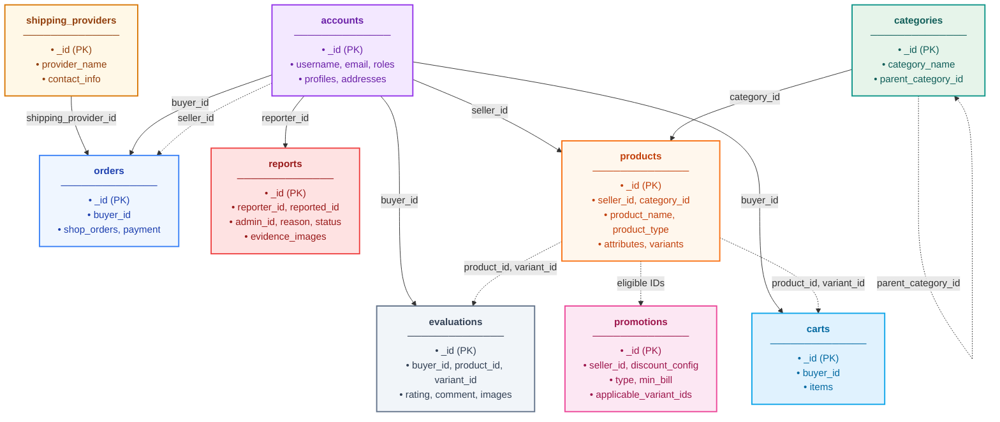

# Thiết Kế Cơ Sở Dữ Liệu MongoDB - Hệ Thống TMĐT BKPEE

Tài liệu này đặc tả mô hình cơ sở dữ liệu Document trong **MongoDB**, đối chiếu trực tiếp với mô hình quan hệ 28 bảng (SQL Server) và sơ đồ thực thể liên kết (ERD) mới nhất của hệ thống.

---

## 1. Triết Lý Thiết Kế: Từ 28 Bảng SQL Sang 9 Collections MongoDB

Trong CSDL quan hệ (SQL Server), dữ liệu được **chuẩn hóa (Normalize)** thành 28 bảng phẳng để giảm dư thừa, nhưng đánh đổi bằng việc phải `JOIN` rất nhiều bảng khi truy vấn.

Trong MongoDB (NoSQL Document Store), chúng ta áp dụng mô hình **Data Modeling for Document Databases**:
1. **Embedding (Nhúng):** Nhúng các thực thể phụ thuộc chặt chẽ (1-1, 1-N nhỏ) có chu kỳ sống cùng nhau vào cùng một Document:
   * `Buyer_Infor` $\rightarrow$ Nhúng thành mảng `addresses` trong `accounts`.
   * `Books`, `Clothes`, `Electronics` & `Book_Author` $\rightarrow$ Nhúng thành thuộc tính đa hình `attributes` trong `products`.
   * `Product_Variant` $\rightarrow$ Nhúng thành mảng `variants` trong `products`.
   * `Shop_Order`, `Shop_Order_Item`, `Payment_Information` $\rightarrow$ Nhúng thành mảng `shop_orders` và object `payment` trong `orders`.
   * `Evaluation_Image`, `Report_Image` $\rightarrow$ Nhúng thành mảng chuỗi `images` trong `evaluations` và `reports`.
   * `Cart_Item` $\rightarrow$ Nhúng thành mảng `items` trong `carts`.
2. **Referencing (Tham chiếu qua `ObjectId` hoặc ID):** Giữ riêng collection khi dữ liệu có kích thước tăng vô hạn (1-N lớn) hoặc được truy cập độc lập từ nhiều nơi:
   * `accounts` $\longleftrightarrow$ `orders` (Tham chiếu qua `buyer_id`, `seller_id`).
   * `categories` $\longleftrightarrow$ `products` (Tham chiếu qua `category_id`).
   * `shipping_providers` $\longleftrightarrow$ `orders` (Tham chiếu qua `provider_id`).

---

## 2. Bảng Đối Chiếu 28 Bảng SQL Server $\rightarrow$ 9 Collections MongoDB

| STT | Collection MongoDB | Gom các Bảng SQL Server tương ứng | Chiến Lược Ánh Xạ |
|---|---|---|---|
| 1 | **`accounts`** | `Account`, `[User]`, `Buyer`, `Buyer_Infor`, `Seller`, `Admin` | Nhúng profiles và sổ địa chỉ (`addresses`) vào cùng 1 account document |
| 2 | **`categories`** | `Category` | Cây danh mục (hỗ trợ `parent_category_id` và mảng `ancestors`) |
| 3 | **`shipping_providers`** | `Shipping_Provider` | Đơn vị vận chuyển và giá cước cơ bản |
| 4 | **`products`** | `Product`, `Books`, `Book_Author`, `Clothes`, `Electronics`, `Product_Variant` | Nhúng thuộc tính theo loại hàng (`attributes`) và mảng biến thể (`variants`) |
| 5 | **`carts`** | `Cart`, `Cart_Item` | Nhúng toàn bộ danh sách món hàng (`items`) vào document giỏ hàng |
| 6 | **`promotions`** | `Promotion`, `Coupon`, `Voucher`, `Promotion_Apply` | Nhúng cấu hình giảm giá (`discount_config`) và mảng `applicable_variant_ids` |
| 7 | **`orders`** | `[Order]`, `Shop_Order`, `Shop_Order_Item`, `Payment_Information` | Nhúng mảng `shop_orders` (kèm items) và thông tin `payment` (Atomic Order) |
| 8 | **`evaluations`** | `Evaluation`, `Evaluation_Image` | Nhúng mảng đường dẫn ảnh `images` vào bài đánh giá |
| 9 | **`reports`** | `Report`, `Report_Image` | Nhúng mảng ảnh chứng cứ `evidence_images` vào phiếu khiếu nại |

---

## 3. Cấu Trúc Document Chi Tiết Của Từng Collection

### 3.1. Collection: `accounts`
```json
{
  "_id": 1,
  "username": "buyer_hienle",
  "password_hash": "$2a$10$hashed_pwd...",
  "fname": "Thúy",
  "lname": "Lê Hiền",
  "phone": "0905000005",
  "email": "thuyhien@bkpee.vn",
  "gender": "Nữ",
  "avatar": "https://bkpee.vn/avatar/buyer1.png",
  "address": "Thủ Đức, TP.HCM",
  "cccd": "079090000005",
  "date_of_birth": "2003-07-25T00:00:00Z",
  "account_status": "ACTIVE",
  "roles": ["BUYER"],
  "user_profile": {
    "trust_score": 100
  },
  "buyer_profile": {
    "addresses": [
      {
        "receiver_name": "Lê Hiền Thúy",
        "phone": "0905000005",
        "address": "KTX Khu A ĐHQG TP.HCM, Dĩ An, Bình Dương",
        "is_default": true
      },
      {
        "receiver_name": "Lê Hiền Thúy",
        "phone": "0905000005",
        "address": "Nhà riêng: 123 Võ Văn Ngân, Thủ Đức, TP.HCM",
        "is_default": false
      }
    ]
  },
  "seller_profile": null,
  "admin_profile": null,
  "created_at": "2026-01-01T00:00:00Z"
}
```

### 3.2. Collection: `categories`
```json
{
  "_id": 4,
  "category_name": "Sách Công Nghệ & Kỹ Thuật",
  "parent_category_id": 1,
  "target_type": "BOOK",
  "ancestors": [
    { "_id": 1, "name": "Sách & Văn Phòng Phẩm" }
  ],
  "admin_id": 1,
  "is_active": true
}
```

### 3.3. Collection: `shipping_providers`
```json
{
  "_id": 1,
  "provider_name": "Giao Hàng Tiết Kiệm (GHTK)",
  "phone": "19006092",
  "address": "Tòa nhà VTV, Cầu Giấy, Hà Nội",
  "admin_id": 1,
  "base_shipping_fee": 22000,
  "is_active": true
}
```

### 3.4. Collection: `products`
```json
{
  "_id": 1,
  "seller_id": 2,
  "category_id": 4,
  "product_name": "Giáo trình Cơ Sở Dữ Liệu (Database Systems)",
  "description": "Sách tham khảo chuẩn quốc tế biên soạn bởi ĐHQG-HCM.",
  "manufacturer": "NXB Đại học Quốc gia",
  "product_type": "BOOK",
  "attributes": {
    "publisher": "Nhà Xuất Bản ĐHQG TP.HCM",
    "authors": ["PGS.TS. Trần Minh", "ThS. Nguyễn Thị Lan"]
  },
  "variants": [
    {
      "variant_id": 1,
      "variant_name": "Bìa Mềm",
      "price": 120000,
      "quantity_stock": 150,
      "is_active": true,
      "image": "https://bkpee.vn/img/books/csdl-tap1.png"
    },
    {
      "variant_id": 2,
      "variant_name": "Bìa Cứng",
      "price": 180000,
      "quantity_stock": 50,
      "is_active": true,
      "image": "https://bkpee.vn/img/books/csdl-biacung.png"
    }
  ],
  "total_stock": 200,
  "min_price": 120000,
  "max_price": 180000,
  "rating_avg": 4.8,
  "rating_count": 25,
  "created_at": "2026-02-15T08:00:00Z"
}
```

### 3.5. Collection: `promotions`
```json
{
  "_id": 1,
  "seller_id": 2,
  "type": "COUPON",
  "quantity": 100,
  "used_count": 12,
  "start_date": "2026-10-01T00:00:00Z",
  "expiration_date": "2026-12-31T23:59:59Z",
  "min_bill": 200000,
  "discount_config": {
    "percent_discount": 15.0,
    "max_discount": 50000
  },
  "applicable_variant_ids": [1, 2],
  "is_active": true
}
```

### 3.6. Collection: `orders`
```json
{
  "_id": 1,
  "buyer_id": 5,
  "buyer_name": "Lê Hiền Thúy",
  "delivery_address": "KTX Khu A ĐHQG TP.HCM, Dĩ An, Bình Dương",
  "order_time": "2026-10-29T14:30:00Z",
  "total_price": 540000,
  "shop_orders": [
    {
      "shop_order_id": 1,
      "seller_id": 2,
      "shop_name": "Fahasa Official Store",
      "shipping_provider": {
        "provider_id": 1,
        "provider_name": "Giao Hàng Tiết Kiệm (GHTK)"
      },
      "tracking_number": "GHTK-FAHASA-001",
      "delivery_status": "DELIVERED",
      "shipping_fee": 22000,
      "shipped_at": "2026-10-29T16:00:00Z",
      "delivered_at": "2026-10-30T09:30:00Z",
      "items": [
        {
          "variant_id": 1,
          "product_id": 1,
          "product_name": "Giáo trình Cơ Sở Dữ Liệu (Bìa Mềm)",
          "quantity": 1,
          "purchase_price": 120000,
          "line_total": 120000
        }
      ]
    },
    {
      "shop_order_id": 2,
      "seller_id": 3,
      "shop_name": "Coolmate Activewear",
      "shipping_provider": {
        "provider_id": 2,
        "provider_name": "Giao Hàng Nhanh (GHN)"
      },
      "tracking_number": "GHN-COOLMATE-002",
      "delivery_status": "SHIPPING",
      "shipping_fee": 25000,
      "shipped_at": "2026-10-29T17:00:00Z",
      "delivered_at": null,
      "items": [
        {
          "variant_id": 3,
          "product_id": 2,
          "product_name": "Áo Thun Thể Thao Nam (Đen, L)",
          "quantity": 2,
          "purchase_price": 199000,
          "line_total": 398000
        }
      ]
    }
  ],
  "payment": {
    "transaction_code": "TXN-BKPEE-20261029-001",
    "payment_method": "VNPAY",
    "payment_status": "COMPLETED",
    "payment_time": "2026-10-29T14:35:00Z"
  }
}
```

### 3.7. Collection: `carts`
```json
{
  "_id": 1,
  "buyer_id": 5,
  "total_product": 3,
  "items": [
    {
      "variant_id": 1,
      "product_id": 1,
      "quantity": 1,
      "added_at": "2026-10-28T10:00:00Z"
    },
    {
      "variant_id": 3,
      "product_id": 2,
      "quantity": 2,
      "added_at": "2026-10-28T10:15:00Z"
    }
  ]
}
```

### 3.8. Collection: `evaluations`
```json
{
  "_id": 1,
  "buyer_id": 5,
  "variant_id": 1,
  "product_id": 1,
  "rating": 5,
  "content": "Sách in rất đẹp, bìa dày dặn, kiến thức chuẩn giáo trình DBMS của trường!",
  "images": [
    "https://bkpee.vn/img/review/sach-thuc-te-1.jpg",
    "https://bkpee.vn/img/review/sach-thuc-te-2.jpg"
  ],
  "created_at": "2026-10-30T10:00:00Z"
}
```

### 3.9. Collection: `reports`
```json
{
  "_id": 1,
  "reporter_id": 5,
  "reported_account_id": 4,
  "admin_id": 1,
  "reason": "Tư vấn sai thông tin sản phẩm",
  "description": "Shop hẹn bảo hành 24 tháng nhưng tem chỉ ghi 12 tháng.",
  "status": "RESOLVED",
  "evidence_images": [
    "https://bkpee.vn/img/report/anh-chup-tem-bao-hanh.jpg"
  ],
  "created_at": "2026-10-28T08:00:00Z",
  "resolved_at": "2026-10-28T17:00:00Z"
}
```

---

## 4. Sơ Đồ Kiến Trúc MongoDB (Mermaid Flowchart Diagram)


